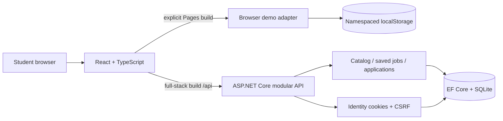

# Handshake Career Lab

An original internship discovery and application project by **Gowtham Reddy**, built with React, TypeScript, ASP.NET Core, Identity and EF Core/SQLite.

[Open the interactive demo](https://gowthamreddy-ch.github.io/handshake-career-lab/) · [Portfolio](https://gowthamreddy-ch.github.io/)

Browse 12 fictional internships, filter by skills and work arrangement, build a shortlist, submit a fictional introduction, and follow or withdraw an application. All employers and opportunities are synthetic. This independent project is unaffiliated with Handshake or any university.

## Two clearly separated experiences

| | Public GitHub Pages demo | Full-stack application |
| --- | --- | --- |
| Purpose | Let recruiters explore the student workflow immediately | Demonstrate backend engineering and persistence |
| Identity | One fictional Maya profile; no password or registration | ASP.NET Core Identity accounts and HttpOnly cookies |
| Storage | This browser's localStorage, scoped to this demo | SQLite database via EF Core migrations |
| Save/apply/withdraw | Simulated locally; no employer is contacted | API validation, ownership checks and transactional writes |
| Security/concurrency evidence | Not an authentication or server-security demonstration | Integration tests cover CSRF, isolation, retries, races and restart persistence |
| Hosting | Static GitHub Pages | Run locally; backend is not deployed by Pages |

The Pages demo asks for **no real credentials or personal information**. Use fictional text. Browser data is not uploaded to the .NET API; GitHub still serves the static website under its own hosting/privacy policies. Reset demo clears only this application's browser storage. Data is local to this browser; separate devices do not share it. Tabs on the same origin share storage, and the demo does not guarantee concurrent multi-tab writes or account isolation.

## Try it in a minute

1. Open the demo and filter for **Remote** or search **SQL**.
2. Start the fictional demo profile and save a role.
3. Apply with at least 50 characters of fictional introduction text.
4. Open Applications, inspect the Submitted state, and withdraw.
5. Refresh to see browser persistence; use Reset demo to start again.

No résumé upload, real applications, employer decisions, email, AI matching, or placement metrics are implied.

## Run the full application

Requirements: Node 22.12+ and .NET SDK 10.0.401 (pinned in `backend/global.json`). No API keys or paid services.

```sh
git clone https://github.com/gowthamreddy-ch/handshake-career-lab.git
cd handshake-career-lab/frontend
npm ci --ignore-scripts
npm run build
cd ../backend
dotnet restore --locked-mode
```

On Windows, from `backend`:

```powershell
./scripts/Start-Demo.ps1
# Portable SDK: add -DotnetExecutable 'C:/path/to/dotnet.exe'
```

Open http://127.0.0.1:4191/. The local-only demo login is `maya@demo.handshake.test` / `HandshakeDemo2026!`. These are deliberately public synthetic credentials. The API seeds them only in demo mode, which requires a loopback binding. New accounts in the full app require 12–128-character passwords with uppercase, lowercase, number and symbol. Do not reuse a real password.

Cross-platform foreground equivalent, from `backend`:

```sh
ASPNETCORE_ENVIRONMENT=Development dotnet run -- --urls http://127.0.0.1:4191 --Demo:Enabled true --Frontend:Path ../frontend/dist
```

The Windows launcher starts a hidden server, writes ignored local logs, and preserves data when stopped with `./scripts/Stop-Demo.ps1`. Use `npm run dev` in `frontend` for hot reload on 4190 while the API runs on 4191. The proxy keeps requests same-origin. **Run `npm run build` before full-stack serving:** `build:pages` intentionally produces a browser-only simulation instead.

## Build the public demo

```sh
cd frontend
npm ci --ignore-scripts
npm run build:pages
node ../scripts/check-pages.mjs
npm run preview -- --mode pages
```

Open http://127.0.0.1:4190/handshake-career-lab/. The build uses the project-site base path and explicitly selects the browser demo adapter. It does not silently fall back to simulation when an API fails.

## Verify

```sh
cd frontend
npm test
npm run build
npm run build:pages
node ../scripts/check-pages.mjs
cd ../backend
node scripts/test-api.mjs
```

The API runner starts its own disposable SQLite database and API on **4192**, tests boundaries and concurrent requests, restarts it to verify persistence, and stops that process. It never targets the interactive 4191 demo. For a portable SDK, set `HANDSHAKE_DOTNET` to the executable and `DOTNET_ROOT` to its directory.

GitHub Actions runs full-stack verification and separately publishes only `frontend/dist`. The backend source, database, session keys and local logs are never part of the Pages artifact. See [the progress log](docs/PROGRESS.md) for observed results and remaining verification limits.

## Architecture



- Search: exact work-mode/field filters and literal AND-token matching over the small synthetic catalog; no unmeasured relevance claim.
- Authentication: established Identity password hashing and HttpOnly cookies with CSRF checks. The API derives ownership from claims.
- Correctness: unique `(UserId, JobId)` and `(UserId, IdempotencyKey)` indexes, request fingerprints, and transactional application/event writes.
- Retry recovery: unchanged requests retain their keys; uncertain auth outcomes read the session before another write. Dialog requests are bounded.
- Time: SQLite materialization restores UTC kinds so original and reloaded application responses agree.
- Scope: one application per user/job, including after withdrawal. Employer workflow is a later milestone.

The original prototype repositories are preserved; this repository consolidates the rehabilitated frontend and backend. See [provenance and decisions](docs/DECISIONS.md).

## Limits and next work

The full backend is local-only; GitHub Pages cannot execute ASP.NET Core. Public API hosting, employer organization ownership, verified email/recovery, HTTPS/proxy setup, protected keys, backups, retention/deletion and production load testing remain future work. Never publish the seeded local database; disabling demo mode does not remove its existing demo account.

The full API's initial synthetic roles expire 31–42 days after first seeding; choose a new local database for a fresh scenario. The Pages catalog is a static demonstration scenario with no real opening/closing status.

Browser-tool initialization failed during this implementation. Builds, adapter tests, API tests and HTTP checks are recorded separately from visual, mobile, keyboard or real-browser interaction checks. No screenshots, accessibility certification, real user research, adoption or hiring outcomes are claimed.
